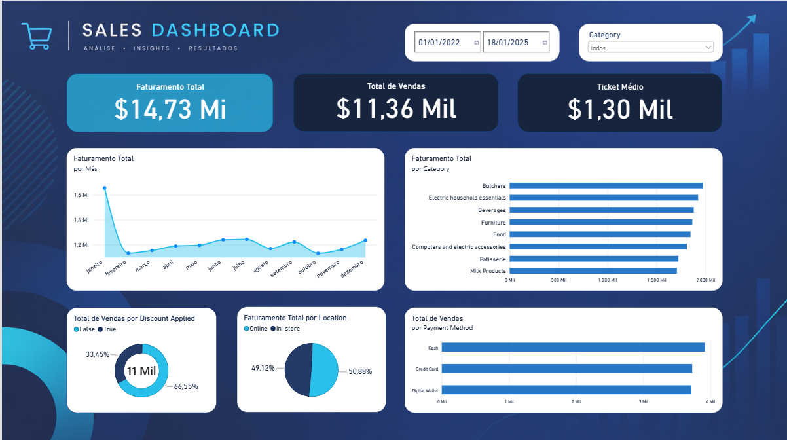

# Limpeza de Dados e Dashboard de Vendas | Retail Store Sales

Projeto de estudo em **Python (Pandas)** e **Power BI**: limpeza e tratamento de um dataset "sujo" de vendas de varejo, seguido da criação de um dashboard para analisar o faturamento.



## Objetivo

Praticar o fluxo de trabalho de um analista de dados: receber um dataset bruto, identificar e corrigir problemas, validar a qualidade dos dados e transformá-los em visualizações que ajudem a entender as vendas.

## Dataset

- **Fonte:** [Retail Store Sales (Dirty for Data Cleaning) no Kaggle](https://www.kaggle.com/datasets/ahmedmohamed2003/retail-store-sales-dirty-for-data-cleaning/data)
- **Arquivo original:** `retail_store_sales.csv`
- **Tamanho:** 12.575 linhas e 11 colunas
- **Período:** janeiro de 2022 a janeiro de 2025
- **Colunas:** `Transaction ID`, `Customer ID`, `Category`, `Item`, `Price Per Unit`, `Quantity`, `Total Spent`, `Payment Method`, `Location`, `Transaction Date`, `Discount Applied`

## Etapas da limpeza (Python)

A limpeza está documentada, com comentários linha a linha, no notebook `AnaliseVenda.ipynb`.

### 1. Correção dos tipos de dados

| Coluna             | Tipo original | Tipo final |
| ------------------ | ------------- | ---------- |
| `Quantity`         | float64       | Int64      |
| `Transaction Date` | texto (str)   | datetime64 |
| `Discount Applied` | object        | boolean    |

### 2. Tratamento de valores ausentes e incorretos

- Verificação de valores vazios e inconsistentes nas colunas `Item`, `Price Per Unit`, `Quantity` e `Total Spent`
- Remoção das linhas sem `Item`
- Preenchimento dos valores ausentes de `Discount Applied` com `False` (assumindo que não houve desconto)

### 3. Verificação final

Conferência da qualidade e da integridade dos dados após o tratamento: tipos corretos, valores vazios restantes e contagem de registros, para garantir que nada foi removido ou alterado de forma errada.

O resultado foi salvo em `retail_store_sales_limpo.csv`, que alimenta o dashboard.

## Dashboard (Power BI)

O dashboard `sales Dashboard.pbix` foi criado a partir do dataset limpo.

**Indicadores (cards):**

- Faturamento total
- Total de vendas
- Ticket médio

**Gráficos:**

- Faturamento total por mês
- Faturamento total por categoria
- Total de vendas por método de pagamento
- Total de vendas com e sem desconto aplicado
- Faturamento total por localização (online x loja física)

**Filtros:** período (data) e categoria.

## Principais descobertas

- **Descontos:** cerca de 66,5% das vendas foram feitas sem desconto e 33,5% com desconto aplicado.
- **Pagamento:** o dinheiro (Cash) é o método mais usado, mas cartão de crédito e carteira digital ficam muito próximos, sem um método dominante.
- **Canal:** as vendas online e em loja física estão praticamente empatadas, em torno de 51% e 49%.
- **Categorias:** o faturamento é bem distribuído entre as categorias. Butchers lidera e Milk Products fica por último, com diferença pequena entre elas.
- **Sazonalidade:** janeiro tem o maior faturamento mensal do período, seguido de uma queda em fevereiro e valores mais estáveis no resto do ano.

## Tecnologias

- Python
- Pandas e NumPy
- Jupyter Notebook
- Power BI

## Estrutura do repositório

```
.
├── AnaliseVenda.ipynb              # limpeza e verificação dos dados
├── retail_store_sales.csv          # dataset original (bruto)
├── retail_store_sales_limpo.csv    # dataset após a limpeza
├── sales Dashboard.pbix            # dashboard do Power BI
├── imagens/
│   └── dashboard.png               # print do dashboard
└── README.md
```

## Como reproduzir

1. Clone o repositório:
   ```bash
   git clone https://github.com/Rafasouza03/NOME-DO-REPOSITORIO.git
   ```
2. Instale as dependências:
   ```bash
   pip install pandas numpy jupyter
   ```
3. Abra o `AnaliseVenda.ipynb` e execute as células em ordem.
4. Para ver o dashboard, abra o arquivo `.pbix` no Power BI Desktop (somente Windows) ou consulte o print acima.

## Próximos passos

- Criar também os gráficos em Python (Matplotlib/Seaborn)
- Aplicar a mesma abordagem em outros datasets, incluindo dados públicos brasileiros

## Autor

**Rafael de Souza Silva**
[GitHub](https://github.com/Rafasouza03) | [LinkedIn](https://www.linkedin.com/in/rafaelde-souzasilva/)
